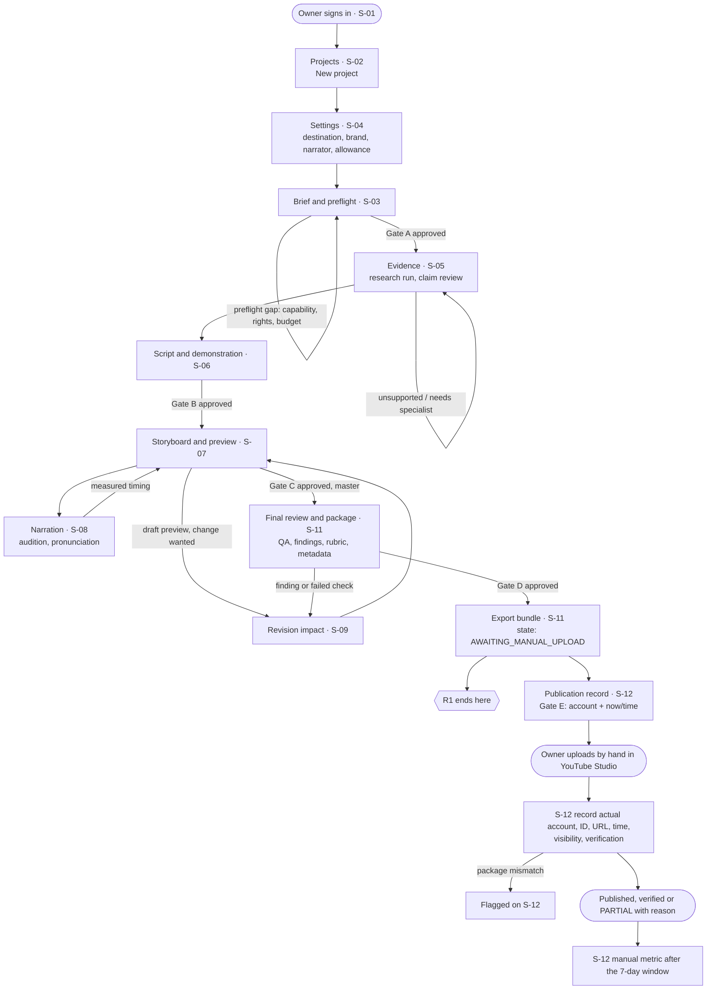
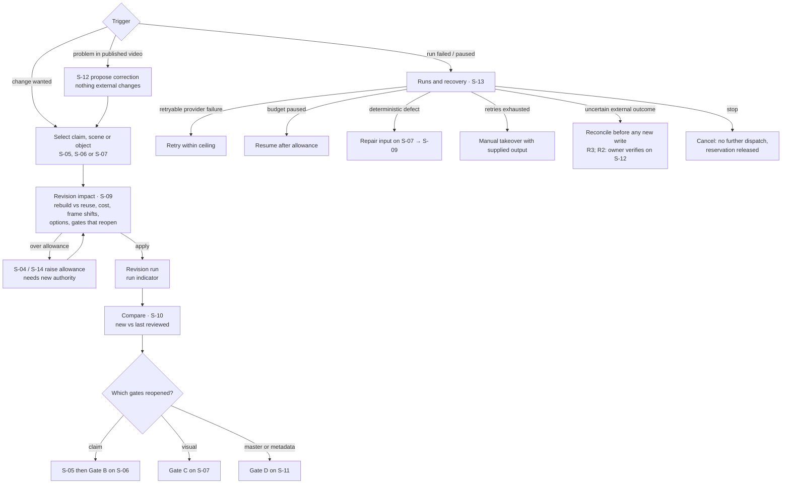
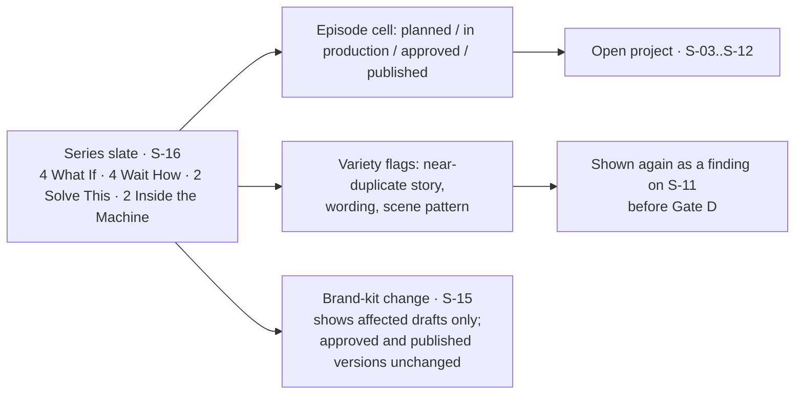

# UI design

Status: **Draft for G2** (Stage 2b; Stage 2c in progress). Screens are listed here, designed by journey on the [Claude Design canvas](https://claude.ai/artifact/6jStrLtkcRDG5GfEf5g8HS) and reviewed there by you; approved screens are then built as HTML prototypes (`docs/design/screens/S-xx-<name>.html`) and approved at G2 (PROCESS.md, Stage 2 screens). S-07 already has an HTML reference prototype. Baselined at G2; after that this doc and the approved screens change only through change control ([PROCESS.md](../PROCESS.md#tracking-and-change-control)).

Owners of related facts: requirements [REQUIREMENTS.md](REQUIREMENTS.md) · assumptions [QUESTIONS.md](QUESTIONS.md) · components and states [ARCHITECTURE.md](../architecture/ARCHITECTURE.md) · API [openapi.yaml](../contracts/openapi.yaml) · who may do what [SECURITY.md](../architecture/SECURITY.md#authentication-and-roles) · Studio UI tokens and video house style [tokens.md](../design/tokens.md).

## Scope and principles

- **One user at R1/R2:** the owner (P01, also acting as P02 reviewer and publisher). Every screen still shows which responsibility an action is taken under (R-05).
- **Structured controls for consequential actions.** Approvals, budget, cancel, takeover, export and publication records are buttons and forms with a confirmation, never free text (R-61, A-28: no chat drafting at R1).
- **Review what you approve.** Every gate dialog shows the exact version and short hash it binds to and the evidence the PRD lists for that gate (R-40, R-41).
- **Honest states.** Unavailable is never shown as empty or zero; "exported" is never shown as "published" (R-46, R-61 AC2, R-72 AC2).
- **Original look.** No reference screenshots exist. The Studio UI style (tokens.md, 2c) and the video house style shown in previews are derived only from PRD §5.2 and the §10 storyboard. Sample data in prototypes is synthetic, using the odd-squares fixture.
- **R3 screens are listed, not prototyped,** until you promote R3 (A-18). They are here so every Should requirement has a home.

## Journeys, stories and what each screen solves

Personas, journeys, stories and the value and moat hypotheses are owned by the PRD (§2.1, §6, §1.1). In scope here: J1 Idea to video, J6 Revision and recovery, J3 Branded series. J2 and J4 (R3) get screens S-17–S-20 after A-18; J5, J7 and J8 are out of scope. The [canvas](https://claude.ai/artifact/6jStrLtkcRDG5GfEf5g8HS) shows each journey as a page of linked screens, plus a "What it solves" page.

Moats (PRD §1.1): 1 typed scene library and compiler · 2 trust · 3 cheap targeted revision · 4 learning loop.

| Screen | Journey step | Stories | Problem it solves | Builds moat |
|---|---|---|---|---|
| S-01 | J1 step 1 | US-01 | Only accountable, signed-in people can act | 2 |
| S-02 | J1 step 2 | US-01, US-10 | One view of every video's state, gates and spend | 2, 3 |
| S-04 | J1 step 3 | US-01, US-10, US-26 | Consistent brand and voice, bounded spend, data you can take away | 2 |
| S-03 | J1 step 4 · Gate A | US-02, US-10 | Not paying for a video that can't be made; hypothesis recorded up front | 1, 4 |
| S-05 | J1 step 5 | US-03 | Scattered, unchecked facts | 2 |
| S-06 | J1 step 6 · Gate B | US-04, US-05 | Plausible-looking but wrong numbers | 1, 2 |
| S-07 | J1 step 7 · Gate C | US-06, US-08 | Animation that looks right but teaches something wrong | 1 |
| S-08 | J1 step 8 | US-07 | Speech and animation drifting apart; speech never sped up | 1 |
| S-11 | J1 step 9 · Gate D | US-11, US-12 | Approving something other than what ships | 2 |
| S-12 | J1 step 10 · Gate E (R2) | US-13, US-19 | “Uploaded” mistaken for “published”; result set against the hypothesis | 2, 4 |
| S-09 | J6 step 1 | US-09, US-10 | A small change meaning a full redo, with surprise costs | 3 |
| S-10 | J6 step 2 | US-11 | Re-reviewing everything after a change | 3, 2 |
| S-13 | J6 step 3 | US-14 | Failures that restart everything or repeat a public action | 3 |
| S-14 | J6 step 4 | US-10 | Unknown cost and effort per video | 3 |
| S-16 | J3 step 1 (R2) | US-21 | A series that keeps repeating itself | 1, 4 |
| S-15 | J3 step 2 | US-01, US-21 | Rights doubts; a brand change breaking published videos | 2 |

## Studio frame (shared on every screen)

| Element | What it shows | Requirements |
|---|---|---|
| App shell | Left nav (Projects, Slate, Library, Runs), signed-in member, responsibilities, environment badge (local / staging), sign-out | R-01, R-05, R-61 |
| Project header | Title, series, production state badge (R-44 states), brief version, destination label and timezone | R-44, R-04 |
| Gate strip | Gates A–E, each: not started · awaiting review · approved (version + hash) · reopened (reason) · blocked (count). Status is text plus icon, never colour alone | R-40, R-41, R-42 |
| Spend meter | Allowance, reserved, actual (INR, provider USD at recorded rate), paused-for-budget state | R-34, R-35, R-61 AC2 |
| Run indicator | Active run, current step, progress from SSE; link to S-13 | R-50 |
| Approval dialog | Gate, target and version hash, responsibility used, evidence checklist, outstanding blockers (each linking to its fix), approve / return with reason | R-40, R-41, R-43, R-09, R-37, R-55, R-59 |
| Error panel | Error class (retryable provider failure, invalid content, deterministic render defect, uncertain public action), the named scene / object / claim / account, and the matching repair button | R-53 |
| Version chip | `v3 · a1b2c3d` with "compare" (S-10) and "history" | R-33, R-41 |

## Screens (S-xx)

Status of every screen is tracked in [STATUS.md](../../plans/STATUS.md#screens). "Prototype" is the 2c file path.

| Screen | Name | Release | Purpose | Main actions | API (openapi.yaml) | Prototype |
|---|---|---|---|---|---|---|
| S-01 | Sign-in and app shell | R1 | Reach the Studio only when signed in; see who you are and under which responsibilities | Sign in (Keycloak hosted login, MFA), sign out; session-expired re-auth | `/me` | S-01-shell.html |
| S-02 | Projects | R1 | Home: every project with state, gate progress, spend and last activity | New project; filter by series and state; open | `/projects` | S-02-projects.html |
| S-03 | Brief and preflight | R1 | Capture the Content Opportunity Contract and check feasibility before paid work | Edit contract (audience, viewer question, promise, series, format, evidence plan, animation family, allowance, hypothesis, measurement plan); run preflight; approve **Gate A**; start research | `/projects/{id}/contracts`, `/preflight`, `/research-runs`, `/approvals` | S-03-brief.html |
| S-04 | Project settings and data | R1 | Destination profile, brand-kit and narrator pins, budget allowance, data export, archive and delete | Set destination (platform, account label, timezone, export profile, disclosure); pick brand version; set allowance (step-up to raise); export project data (step-up); archive; delete a never-published project (step-up, type the title to confirm) | `/projects/{id}` (incl. DELETE), `/destination`, `/budget`, `/data-exports` | S-04-settings.html |
| S-05 | Evidence | R1 | Claim ledger beside its sources; review each claim | Run or re-run research; add a claim with evidence; mark approved / qualified / unsupported / contradicted / needs specialist / removed; open claim detail (sources, locator, excerpt, every beat and scene using it) | `/claims`, `/claims/{id}`, `/research-runs` | S-05-evidence.html |
| S-06 | Script and demonstration | R1 | Narration beats side by side with their claims and the verified demonstration | Generate or edit script; edit hook; compute demonstration with reviewed parameters; label example / approximation / illustration; policy checklist; approve **Gate B** | `/script-runs`, `/scripts`, `/demonstrations`, `/approvals` | S-06-script.html |
| S-07 | Storyboard and preview | R1 (R0 sample) | Scene cards and a scene and caption strip with a playhead, around the Remotion Player and its own controls; see what objects do and when | Generate storyboard; inspect object (ID, colour, meaning, label) and action (op, targets, frames, easing, anchor); see compiler errors and capability gaps per scene; render draft preview or hook-only preview; request a change (→ S-09); approve **Gate C** | `/storyboard-runs`, `/storyboards`, `/capabilities`, `/renders` | [S-07-storyboard.html](../design/screens/S-07-storyboard.html) (reference, client review) |
| S-08 | Narration | R1 (R0 sample) | Audition voice per scene and fix pronunciation before the master | Generate take (whole or per scene); play per scene; edit pronunciation list (including notation); see measured duration vs plan and the pacing change; see take licence (plan, commercial use) | `/narration-takes`, `/pronunciations` | S-08-narration.html |
| S-09 | Revision impact | R1 (R0 sample) | Before regenerating, see exactly what a change costs and reopens | Describe the change on a claim, scene or object; view rebuild vs reuse lists, estimated cost, frame shifts, options (extend or shorten another beat), gates that reopen; apply | `/revisions/impact`, `/revisions/{id}/apply` | S-09-revision.html |
| S-10 | Compare versions | R1 | Compare a revised script, storyboard or master with the last reviewed one | Pick two versions; side-by-side text diff, scene diff, synced dual player for masters | `/compare` | S-10-compare.html |
| S-11 | Final review and package | R1 | Review the final-quality master and approve the exact export package | Play master (phone-size frame and full size); media QA results; findings with disposition; rubric (5 dimensions incl. muted-with-captions); metadata, cover, description with attribution; audience (made-for-kids) setting with no default; AI disclosure assessment; rights and provenance; approve **Gate D**; build export bundle | `/renders/{id}`, `/findings`, `/renders/{id}/rubric`, `/packages`, `/exports`, `/approvals` | S-11-package.html |
| S-12 | Publication record | R2 | Record a manual upload truthfully and keep it honest afterwards | Approve **Gate E** (account, publish-now or time); record actual account, external ID, URL, time, visibility; record verification (NOT_CHECKED / PASSED / PARTIAL / FAILED) with evidence; flag package mismatch; propose a correction; enter manual metric (labelled manual, cold-start) | `/publications`, `/verifications`, `/corrections`, `/metric-snapshots`, `/approvals` | S-12-publication.html |
| S-13 | Runs and recovery | R1 | Every run, its attempts, failures, retries and spend; recover safely | Filter runs; open run detail (attempt timeline, model and tool versions, prompt hash, error class, cost); retry within ceiling; resume after budget or approval; cancel; manual takeover with supplied output | `/projects/{id}/runs`, `/runs/{id}`, `/cancel`, `/resume`, `/takeover` | S-13-runs.html |
| S-14 | Cost and effort | R1 | Allowance, reservations and actual cost per attempt; active human minutes; manual baseline | View estimated vs actual per attempt (failed and revised included); record effort by activity (incl. code repair); record the KPI-04 manual baseline (Q-13) | `/budget`, `/costs`, `/effort`, `/kpi-baselines` | S-14-cost.html |
| S-15 | Library | R1 (basic) | Rights ledger, approved reusable assets and brand-kit versions | Register asset (origin, hash, licence, expiry) and upload; view licence and version history; create a brand-kit version and see which draft scenes it invalidates | `/assets`, `/brand-kits`, `/brand-kits/{id}/versions` | S-15-library.html |
| S-16 | Series slate | R2 | Planned vs approved vs published per series against 4/4/2/2; variety flags | Open an episode; see near-duplicate story, wording and scene-pattern flags | `/series/slate` | S-16-slate.html |
| S-17 | Connections | R3 planned | Connected accounts, actual identity, scopes and tested capabilities | Connect YouTube; check Instagram eligibility; revoke | added by the R3 spec | after A-18 |
| S-18 | Publishing calendar | R3 planned | Connected releases per account: package, schedule, status, uncertainty | Private upload; readiness; release or schedule (local time); cancel pending until confirmed; reconcile PUBLICATION_UNKNOWN | added by the R3 spec | after A-18 |
| S-19 | Opportunity Lab | R3 planned | Compare candidate ideas before production | Edit ratings; see weighted heuristic score, rationale, evidence, uncertainty, effort, cost and blockers; select → new contract | added by the R3 spec | after A-18 |
| S-20 | Analytics and experiments | R3 planned | Results against the recorded hypothesis; recommendations as proposals | View metric dictionary per value (definition, window, denominator, availability); experiment record; accept or reject a recommendation; growth-study tracking | added by the R3 spec | after A-18 |

No screen exists for R-64/R-65 (Could, A-28) or R-78–R-82 (Won't).

## Flows

Each flow names the screen and the in-app gate (A–E, PRD §8.1) at every step. Gates are product features, not delivery gates G1–G5.

### J1 Idea to approved channel video (R1 export, R2 manual publication)

Branches (PRD §6.3): missing evidence returns to S-05; unsupported animation is caught by preflight on S-03 or compiler errors on S-07 before paid work; render errors follow J6; an expired session at any step returns to S-01 and back to the same screen without losing saved versions.

### J6 Targeted revision and failure recovery (R1; publication branches R2)

Earlier approved and published masters stay in history (version chip → history). A correction creates a new version; it never deletes or replaces the external post without a new Gate E (R-49).

### J3 Series slate view (R2)

Each episode keeps its own costs, approvals and release; selecting several on S-16 never approves or releases them together (PRD §6.5).

## Empty, loading and error states

Every prototype in 2c shows its empty, loading and error states. Shared rules first, then what is specific per screen.

**Shared rules**
- **Empty** explains why and offers the next action ("No claims yet. Run research or add a claim."). Empty is used only when the data truly has no items.
- **Unavailable** is a distinct state with a reason ("Average % viewed: not entered yet", "Not supported by this platform"), never a blank, dash or zero (R-61 AC2, R-72 AC2).
- **Loading** uses skeletons for lists and panels; long work shows the run indicator with the current step from SSE, never a spinner without a step. If SSE drops, a banner says "Live updates paused, reconnecting" and the screen re-queries on reconnect.
- **Errors** use the error panel (R-53). API problem types map as: 401 → re-authenticate (S-01) and return; 403 `step_up_required` → MFA prompt in place, the dialog keeps its content; other 403 → "Your responsibility does not allow this" naming the one needed; 404 → not found in this workspace; 409 blocker → list of blockers with links; 412 stale version → "Changed since you opened it" with reload and compare; 422 validation → field-level messages naming scene and field; 5xx → retry with the request ID shown.
- **Paused** states (budget, awaiting approval) are not errors: they show what is waiting and the one action that unblocks it.

| Screen | Empty | Loading | Error / blocked |
|---|---|---|---|
| S-01 | — | Redirecting to sign-in | Sign-in failed or MFA missing; session expired mid-task |
| S-02 | First run: "Create your first project" | Project list skeleton | API unreachable (stack not running locally) |
| S-03 | New contract form with required fields marked | Preflight running | Preflight gaps listed (capability, rights, budget); Gate A blocked |
| S-04 | Destination not set (blocks Gate D later) | Deletion run in progress | Reference channel chosen as destination refused (R-04 AC3); stale version; delete refused for a published project (offers archive); step-up needed |
| S-05 | No claims yet; research not run | Research run steps (search, fetch, extract) | Citation invalid; source fetch refused (unsafe address, size, type); claim needs specialist and you lack the scope |
| S-06 | No script yet | Script run | Unknown claim reference; demonstration domain error or mismatch; policy checklist failure blocks Gate B |
| S-07 | No storyboard yet | Storyboard run; preview rendering with per-scene progress | Compiler errors per scene and field (unknown reference, frame out of range, continuity break, colour meaning, caption overlap, safe zone); capability gap; preview layout failure |
| S-08 | No take yet | Take generating | TTS provider failure (retryable); take no longer fits (pacing change shown, never silent speed-up); free-plan take flagged "not publishable" |
| S-09 | Nothing changed | Computing impact | Impact exceeds remaining allowance; change touches an approved version (shows which gates reopen) |
| S-10 | Only one version exists | Loading both versions | One version deleted by retention (shown as retained metadata only) |
| S-11 | No master yet | Master rendering; QA running | Failed media check; open material finding; rights blocker (incl. narration without commercial licence); audience setting unset; Gate D refused with blockers |
| S-12 | Awaiting manual upload | — | Gate E not current for this package or account; recorded URL's package differs from approved (flag); verification PARTIAL needs a reason |
| S-13 | No runs | Live attempt timeline | Each error class with its repair; retries exhausted; uncertain external outcome |
| S-14 | No spend yet | — | Allowance not set (paid dispatch blocked); reservation exceeds allowance |
| S-15 | No assets registered | Upload progress | Unlicensed or expired asset; hash mismatch after upload |
| S-16 | Slate not planned | — | Variety flags; episode blocked |

## Accessibility

Standard per A-17: **WCAG 2.2 AA** for the Studio.

- **Contrast:** text 4.5:1, large text and UI graphics 3:1, in both light and dark Studio themes (tokens in 2c are checked against these ratios).
- **Not colour alone:** gate status, claim status, QA results and object colour meaning always pair colour with text, icon or shape (also R-20 AC2 for the video).
- **Keyboard:** every action reachable by keyboard in a logical order; visible focus (2.4.7, 2.4.11 focus not obscured); dialogs trap and return focus; the player has keyboard play, pause, frame step and scene jump; scene cards and the scene strip are reachable by keyboard.
- **Targets:** at least 24 × 24 px (2.5.8); dragging the seek bar always has a non-drag alternative (2.5.7): frame step buttons and a frame number input.
- **Motion and flashing:** Studio UI motion respects `prefers-reduced-motion`; nothing in the Studio flashes more than three times per second. Video content is checked separately by `media.qa` (≤ 3 flashes/s, NFR-08).
- **Media review:** S-11 offers a muted-with-captions playback mode and a phone-size frame so the KPI-14 review is done the way viewers watch (PRD §2.2).
- **Forms:** labels on every field, errors announced and linked to the field, no time limits on review screens except the signed media URL, which renews silently.
- **Status messages:** run progress and SSE updates use polite live regions, not focus moves.

## Devices and browsers

Per A-26: current desktop **Chrome, Safari and Firefox**, at **1280 px wide and above**. Below 1280 px the Studio shows a notice and a single-column layout that still works but is not designed for. No mobile Studio. Video previews show a phone-size frame (1080×1920 scaled to fit, for example 360×640) with a toggle to 100% for detail checks; captions and safe zones are shown as an overlay toggle.

## Languages and formats

English only, for the Studio and for narration (NFR-16). No translation layer is built; all strings live in one module so a later change is possible without a rewrite.

- **Times:** stored UTC; displayed in the destination timezone (initially Asia/Kolkata), with the zone shown, e.g. `13 Nov 2026, 14:05 IST` (R-04 AC1).
- **Money:** INR as the reporting currency, en-IN grouping (₹1,23,450); provider amounts also shown in USD with the recorded rate (Q-05).
- **Frames and time:** scene and action times shown as both seconds and frames at 30 fps (`12.4 s · f372`).

## Requirement → screen map

Every user-facing Must and Should requirement maps to at least one screen. Requirements with no direct UI say where their effect is visible. Could and Won't items are not designed.

| R | Pri | Screens | Notes |
|---|---|---|---|
| R-01 | Must | S-01, S-02 | Unauthenticated requests never reach a screen |
| R-02 | Must | S-15, S-04 | New brand version shows affected draft scenes |
| R-03 | Must | S-04, S-08 | |
| R-04 | Must | S-04, S-11 | Audience setting set per package on S-11 |
| R-05 | Must | S-01, all approval dialogs | Responsibility shown and recorded |
| R-06 | Must | S-03 | |
| R-07 | Must | S-03, S-07 | |
| R-08 | Must | S-05 | |
| R-09 | Must | S-05, S-06, S-11 | Blockers in Gate B and D dialogs |
| R-10 | Must | S-05, S-06 | Claim detail lists using beats and scenes |
| R-11 | Must | S-06 | |
| R-12 | Must | S-06, S-07 | Mismatch names scene, object, expected value |
| R-13 | Must | S-06, S-07 | Label badge on demonstration and scene |
| R-14 | Must | S-06 | |
| R-15 | Must | S-06, S-07 | Hook-only preview |
| R-16 | Must | S-07 | |
| R-17 | Must | S-06, S-07, S-11 | Each layer has its own gate and version chip |
| R-18 | Must | S-07 | Compiler errors per scene and field |
| R-19 | Must | S-07 | Family shown per scene; components are media layer |
| R-20 | Must | S-07 | Object inspector: ID, colour, meaning, label |
| R-21 | Must | S-07 | Action list per scene and action inspector (op, targets, frames, easing, anchor); no multi-track timeline (PRD §13 defers it) |
| R-22 | Must | S-07, S-09 | Continuity flags; inheriting scenes marked invalid |
| R-23 | Must | S-07, S-11, S-15 | House style visible in previews; brand kit in S-15 |
| R-25 | Must | S-08 | |
| R-26 | Must | S-08, S-07 | Pacing change shown, never silent |
| R-27 | Must | S-07, S-11 | Caption strip and overlay; QA result |
| R-28 | Must | S-07 | |
| R-29 | Must | S-11 | Media QA results |
| R-30 | Must | S-11, S-13 | Manifest view |
| R-31 | Must | S-09 | |
| R-32 | Must | S-09 | Rebuild vs reuse lists |
| R-33 | Must | S-10 | |
| R-34 | Must | S-14, S-04, S-13 | Allowance; paused-for-budget runs |
| R-35 | Must | S-14, S-13 | |
| R-36 | Must | S-14, S-11 | Effort on S-14; rubric on S-11 |
| R-37 | Must | S-11 | Findings also raised from S-06, S-07 |
| R-38 | Must | S-11 | |
| R-39 | Must | S-16, S-11 | |
| R-40 | Must | S-03, S-06, S-07, S-11, S-12 | Gate strip on every project screen |
| R-41 | Must | All approval dialogs | Version and hash shown; stale approval refused |
| R-42 | Must | Gate strip, S-09 | Reopened gates with reason |
| R-43 | Must | Approval history | No UI path for agents; history shows actor type |
| R-44 | Must | Project header, S-02 | |
| R-45 | Must | S-11 | |
| R-46 | Must | S-11, S-12 | "Awaiting manual upload", never "published" |
| R-47 | Must | S-12 | |
| R-48 | Must/Should | S-12; S-18 (R3) | |
| R-49 | Must | S-12 | |
| R-50 | Must | S-13 | |
| R-51 | Must | S-13 | |
| R-52 | Must | S-13 | |
| R-53 | Must | All (error panel), S-13 | |
| R-54 | Must | S-11, S-13 | Provenance panel |
| R-55 | Must | S-15, S-11 | |
| R-56 | Must | S-04 | |
| R-57 | Must | S-03 | Series chosen in the brief |
| R-58 | Must | S-16 | |
| R-59 | Must | S-06, S-11 | Policy checklist in Gate B and D dialogs |
| R-60 | Must | S-04, S-11 | |
| R-61 | Must | All | Frame elements: spend meter, unavailable state |
| R-62 | Must | S-15 | |
| R-63 | Must | S-13 | Task budgets and attempts visible; contracts are agent layer |
| R-66 | Should | S-17 | R3 planned |
| R-67 | Should | S-17 | R3 planned |
| R-68 | Should | S-18 | R3 planned |
| R-69 | Should | S-18, S-12 | Gate E dialog reused |
| R-70 | Should | S-18 | R3 planned |
| R-71 | Should | S-18 | R3 planned |
| R-72 | Should | S-12 (manual at R2), S-20 | |
| R-73 | Should | S-19 | R3 planned |
| R-74 | Should | S-20 | R3 planned |
| R-75 | Should | S-20 | R3 planned |
| R-76 | Should | S-20 | R3 planned |
| R-77 | Should | S-20 | R3 planned |
| R-24, R-64, R-65 | Could | — | Not designed |
| R-78–R-82 | Won't | — | Not designed |

NFRs with UI effect: NFR-04 (S-01, signed media URLs), NFR-08 (S-11 muted review), NFR-09 (S-13 one hop from run to artifacts), NFR-10 (S-04 data export, archive and delete), NFR-15 (S-13 stuck runs), NFR-18 (unavailable capability shown, export offered).
