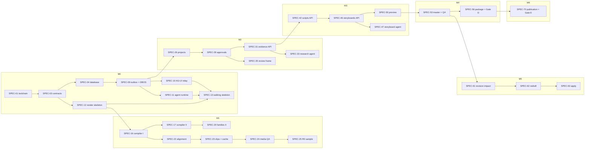

# Development plan

Status: **Draft for G3** (Stage 3, 14 Nov 2026). A living doc: specs are added, split or reordered as milestones are prepared (Stage 4), and this file is updated in the same PR. Engineering view of the plan; the client view (milestones, dates, RAID) is [DELIVERY_PLAN.md](DELIVERY_PLAN.md) and the test levels, T-xx catalogue and Definition of Done are in [TEST_STRATEGY.md](TEST_STRATEGY.md).

Owners of related facts: requirements [REQUIREMENTS.md](../docs/product/REQUIREMENTS.md) · screens [UI_DESIGN.md](../docs/product/UI_DESIGN.md) and [docs/design/screens/](../docs/design/screens/) · components [ARCHITECTURE.md](../docs/architecture/ARCHITECTURE.md) · agents [AGENT_ARCHITECTURE.md](../docs/architecture/AGENT_ARCHITECTURE.md) · tools [TECH_STACK.md](../docs/architecture/TECH_STACK.md) · decisions [ADRs](../docs/adr/README.md) · contracts [docs/contracts](../docs/contracts/README.md) · coding rules [AGENTS.md](../AGENTS.md) and [.cursor/rules/](../.cursor/rules/).

## How to read the spec tables

- **One spec = one PR = one branch**, about 1–3 days of work and under about 400 changed lines (PROCESS.md, Definition of Ready). A spec that grows past that is split in Stage 4 and this table is updated.
- **Size:** S = 1 spec-day, M = 2, L = 3. A **spec-day** is one focused day of implementation and review with Cursor, about 5 hours of the owner's time (A-36, [QUESTIONS.md](../docs/product/QUESTIONS.md)). Calendar dates are derived in [DELIVERY_PLAN.md](DELIVERY_PLAN.md#dates-demos-and-uat).
- **Layer** (ADR-001): **B** backend (`backend/`: api, worker) · **A** agent (`agent/`) · **M** media (`media/scenes`, `media/audio`) · **W** web (`web/`) · **X** cross-cutting (toolchain, CI, contracts, ops). `B+W` and `B+M` specs touch two layers through one contract change.
- **Requirements** lists the R-xx and NFR-xx whose acceptance criteria the spec implements or extends. A requirement spanning several specs is accepted when its last spec merges ([requirement → milestone map](DELIVERY_PLAN.md#requirements-to-milestones)).
- **Tests** are T-xx from the [catalogue](TEST_STRATEGY.md#test-catalogue-t-xx). T-01–T-14 are the agent conformance scenarios C01–C14; T-15–T-30 are the screen tests for S-01–S-16.
- Every frontend spec names the approved screen it builds, from `docs/design/screens/S-xx-<name>.html`.

Totals: **83 specs, 185 spec-days** (M0 32, M1 28, M2 33, M3 26, M4 19, M5 22, M6 13, M7 12).

## Features → specs

Every Must feature has specs. Should features F-18–F-20 are R3, built only after you sign the R2 gate and promote R3 (A-18). R-24, R-64 and R-65 (Could) and F-21 (Won't) are not planned.

| Feature | Name | Priority | Specs |
|---|---|---|---|
| F-01 | Workspace, brand and project setup | Must | SPEC-04, SPEC-06, SPEC-07, SPEC-18, SPEC-21, SPEC-26, SPEC-27, SPEC-28, SPEC-35, SPEC-36, SPEC-37, SPEC-48, SPEC-49, SPEC-55, SPEC-56, SPEC-58, SPEC-59 |
| F-02 | Idea intake and brief | Must | SPEC-16, SPEC-30, SPEC-38, SPEC-46, SPEC-51 |
| F-03 | Research, claims and evidence | Must | SPEC-14, SPEC-31, SPEC-32, SPEC-33, SPEC-39, SPEC-44, SPEC-56 |
| F-04 | Verified demonstrations | Must | SPEC-15, SPEC-17, SPEC-41, SPEC-44, SPEC-45 |
| F-05 | Script and storyboard | Must | SPEC-25, SPEC-42, SPEC-43, SPEC-45, SPEC-46, SPEC-47, SPEC-50, SPEC-51, SPEC-52 |
| F-06 | Signal Motion Engine | Must (R-24 Could) | SPEC-03, SPEC-16, SPEC-17, SPEC-18, SPEC-19, SPEC-20, SPEC-22, SPEC-46, SPEC-47, SPEC-51, SPEC-52, SPEC-61 |
| F-07 | Narration, timing and captions | Must | SPEC-17, SPEC-21, SPEC-22, SPEC-24, SPEC-48, SPEC-49, SPEC-52 |
| F-08 | Preview and master render | Must | SPEC-05, SPEC-12, SPEC-23, SPEC-24, SPEC-50, SPEC-52, SPEC-53, SPEC-57 |
| F-09 | Targeted revision | Must | SPEC-23, SPEC-25, SPEC-61, SPEC-62, SPEC-63, SPEC-64, SPEC-65 |
| F-10 | Cost and effort control | Must | SPEC-21, SPEC-25, SPEC-27, SPEC-29, SPEC-35, SPEC-37, SPEC-60, SPEC-67 |
| F-11 | Quality review | Must | SPEC-54, SPEC-56, SPEC-57, SPEC-74, SPEC-75 |
| F-12 | Approval governance | Must | SPEC-26, SPEC-28, SPEC-35, SPEC-36, SPEC-38, SPEC-42, SPEC-45, SPEC-51, SPEC-53, SPEC-58, SPEC-61, SPEC-63, SPEC-64, SPEC-70 |
| F-13 | Package, export and manual publication | Must | SPEC-56, SPEC-58, SPEC-70, SPEC-71, SPEC-72 |
| F-14 | Runs, recovery and cancellation | Must | SPEC-09, SPEC-10, SPEC-34, SPEC-40, SPEC-66 |
| F-15 | Provenance, rights and data control | Must | SPEC-18, SPEC-48, SPEC-53, SPEC-55, SPEC-56, SPEC-58, SPEC-59, SPEC-68 |
| F-16 | Editorial series and content policy | Must | SPEC-30, SPEC-38, SPEC-43, SPEC-44, SPEC-45, SPEC-56, SPEC-73, SPEC-74, SPEC-75, SPEC-76 |
| F-17 | Studio and agent tasks | Must (R-64, R-65 Could) | SPEC-07, SPEC-10, SPEC-11, SPEC-33, SPEC-34, SPEC-35, SPEC-40, SPEC-43, SPEC-47, SPEC-55, SPEC-59, SPEC-62 |
| F-18 | Channel connection | Should (R3) | R3, conditional on A-18: outlined in DELIVERY_PLAN.md, not specced |
| F-19 | Connected publishing | Should (R3) | R3, conditional on A-18: outlined in DELIVERY_PLAN.md, not specced |
| F-20 | Audience learning and experiments | Should (R3) | SPEC-71, SPEC-72 (R-72 manual entry at R2 only; the rest is R3, conditional on A-18) |
| F-21 | Customer and business expansion | Won't | Won't: not planned |
| — | Cross-cutting (NFR only) | Must | SPEC-01, SPEC-02, SPEC-08, SPEC-13, SPEC-69, SPEC-77, SPEC-78, SPEC-79, SPEC-80, SPEC-81, SPEC-82, SPEC-83 |

## Specs by milestone

Milestones are defined in [DELIVERY_PLAN.md](DELIVERY_PLAN.md#milestones). Each milestone's specs get their `spec.md` and `prompt.md` in `plans/Mx/specs/SPEC-xx/` when the milestone is prepared (Stage 4).

### M0 Foundation: walking skeleton

Contracts first: SPEC-03 regenerates contracts 0.4.0 from Pydantic as 1.0.0 before any layer codes against them (ADR-008). SPEC-09 is the DBOS kill-and-resume spike; if it fails, ADR-003 is superseded before M1 work depends on it. SPEC-05 replaces the interim MinIO image (ADR-015). SPEC-14 decides Q-29. The owner's discovery tasks run alongside (see [DELIVERY_PLAN.md](DELIVERY_PLAN.md#m0-foundation)).

| Spec | Title | Layer | Requirements | Screens | Tests | Depends on | Size | Branch |
|---|---|---|---|---|---|---|---|---|
| SPEC-01 | Repo toolchain, Makefile and Compose stack | X | NFR-13 | — | T-31 | — | M | `feat/SPEC-01-toolchain` |
| SPEC-02 | CI pipeline, security scans and branch rules | X | NFR-05, NFR-06, NFR-13, NFR-18 | — | T-32 | SPEC-01 | M | `feat/SPEC-02-ci-pipeline` |
| SPEC-03 | Canonical Pydantic contracts, generated JSON Schema and TS (contracts 1.0.0) | X | NFR-19, R-18, NFR-11 | — | T-33 | SPEC-01 | L | `feat/SPEC-03-contracts-codegen` |
| SPEC-04 | Database baseline, migrations, service roles and RLS | B | R-01, NFR-04, NFR-13 | — | T-34, T-07 | SPEC-01, SPEC-03 | M | `feat/SPEC-04-database` |
| SPEC-05 | Object store choice and BlobStore adapter (ADR-015 amendment) | B | R-30, NFR-04 | — | T-35 | SPEC-01 | M | `feat/SPEC-05-object-store` |
| SPEC-06 | API authentication, members and responsibilities | B | R-01, R-05, NFR-04 | — | T-36, T-37 | SPEC-04 | M | `feat/SPEC-06-api-auth` |
| SPEC-07 | Studio sign-in and app shell | W | R-01, R-05, R-61 | S-01 | T-15, T-36 | SPEC-06 | M | `feat/SPEC-07-studio-shell` |
| SPEC-08 | Telemetry wiring, Collector redaction and health checks | X | NFR-09, NFR-06, NFR-15 | — | T-38 | SPEC-01 | M | `feat/SPEC-08-telemetry` |
| SPEC-09 | Outbox, dispatcher and DBOS kill-and-resume spike (ADR-003) | B | NFR-01, R-50, R-51 | — | T-01, T-04, T-12, T-90 | SPEC-04 | L | `feat/SPEC-09-outbox-dbos` |
| SPEC-10 | AG-UI relay and project event stream (ADR-020) | B | R-50, R-61, NFR-04 | — | T-10, T-39, T-07 | SPEC-06, SPEC-09 | L | `feat/SPEC-10-agui-relay` |
| SPEC-11 | Agent runtime, tool host, LLM adapter and fake model (ADR-021) | A | R-63, NFR-05, NFR-11 | — | T-02, T-08, T-09, T-91 | SPEC-03, SPEC-09 | L | `feat/SPEC-11-agent-runtime` |
| SPEC-12 | Render service skeleton, job API and resource limits | M | R-29, NFR-12 | — | T-40 | SPEC-03, SPEC-05 | M | `feat/SPEC-12-render-skeleton` |
| SPEC-13 | Walking skeleton: web → api → worker → agent → render, traced | X | NFR-09, NFR-13 | S-01 | T-03, T-41 | SPEC-07, SPEC-08, SPEC-10, SPEC-11, SPEC-12 | M | `feat/SPEC-13-walking-skeleton` |
| SPEC-14 | Search API choice and SearchProvider adapter (Q-29) | A | R-08, NFR-11 | — | T-42 | SPEC-11 | M | `feat/SPEC-14-search-provider` |

### M1 Feasibility: the R0 sample

Media layer first, as PRD §22 asks: prove one mathematical visual story before the Studio. The R0 sample is driven from a command (`make r0-sample`) over the M0 API and workflows, with the VideoSpec authored from the odd-squares fixture (R-16 is an R0 sample here; the storyboard agent arrives in M3). After M1 the estimate is redone (PRD §22.1) and the renderer is confirmed before the Studio is coupled to it (PRD §22.2).

| Spec | Title | Layer | Requirements | Screens | Tests | Depends on | Size | Branch |
|---|---|---|---|---|---|---|---|---|
| SPEC-15 | Allowlisted demonstration functions | B | R-11, R-12 | — | T-43 | SPEC-03 | M | `feat/SPEC-15-demonstrations` |
| SPEC-16 | Compiler I: schema, references, timing, capabilities, limits (TS + Python mirror) | M | R-18, R-21, R-07, NFR-05, NFR-12, NFR-16 | — | T-44, T-40 | SPEC-03, SPEC-12 | L | `feat/SPEC-16-compiler-core` |
| SPEC-17 | Compiler II: demonstration values, continuity, colour meaning, layout | M | R-12, R-20, R-22, R-23, R-27 | — | T-45 | SPEC-15, SPEC-16 | L | `feat/SPEC-17-compiler-semantics` |
| SPEC-18 | House style brand kit v1 and fonts in media/scenes | M | R-23, R-02, R-55, NFR-08 | — | T-46 | SPEC-12 | M | `feat/SPEC-18-house-style` |
| SPEC-19 | Scene families I: MathExpression, NumberSequence, CaptionAndTakeaway | M | R-19, R-20 | — | T-46 | SPEC-16, SPEC-18 | L | `feat/SPEC-19-families-1` |
| SPEC-20 | Scene families II: GeometricArrangement, ObjectTransform, FocusHighlight | M | R-19, R-20, R-22 | — | T-46 | SPEC-17, SPEC-19 | L | `feat/SPEC-20-families-2` |
| SPEC-21 | TTS adapter, narration takes and pronunciation (ADR-013) | M | R-25, R-03, R-35, NFR-11 | — | T-47, T-91 | SPEC-05, SPEC-09 | M | `feat/SPEC-21-tts` |
| SPEC-22 | Measured alignment, timing compile and caption segmentation | M | R-26, R-27, R-21 | — | T-48 | SPEC-16, SPEC-21 | L | `feat/SPEC-22-alignment-captions` |
| SPEC-23 | Scene clips, render cache, assembly, mix and manifest | M | R-29, R-30, R-32, NFR-03 | — | T-49, T-50, T-03 | SPEC-19, SPEC-22 | L | `feat/SPEC-23-clips-cache` |
| SPEC-24 | Media QA checks on previews and masters | M | R-29, R-27, NFR-08 | — | T-51 | SPEC-23 | M | `feat/SPEC-24-media-qa` |
| SPEC-25 | R0 pipeline command and the odd-squares sample with a targeted revision | X | R-16, R-31, R-32, R-35, R-36, NFR-02 | — | T-52 | SPEC-15, SPEC-20, SPEC-24 | M | `feat/SPEC-25-r0-sample` |

### M2 Brief to evidence (R1, J1 steps 1–5)

Control plane (projects, settings, approvals, budget), the brief with preflight and Gate A, the research agent and claim review, and the shared Studio frame every later screen uses.

| Spec | Title | Layer | Requirements | Screens | Tests | Depends on | Size | Branch |
|---|---|---|---|---|---|---|---|---|
| SPEC-26 | Projects, production state machine, If-Match, idempotency and audit | B | R-01, R-44, NFR-04 | — | T-53, T-01, T-07 | SPEC-06, SPEC-09 | M | `feat/SPEC-26-projects` |
| SPEC-27 | Brand kit versions, narrator, destination and allowance | B | R-02, R-03, R-04, R-34 | — | T-54 | SPEC-26 | M | `feat/SPEC-27-project-settings` |
| SPEC-28 | Approvals: gates A–E, version binding, policy versions, invalidation | B | R-05, R-40, R-41, R-42, R-43 | — | T-55, T-05, T-37 | SPEC-26 | L | `feat/SPEC-28-approvals` |
| SPEC-29 | Budget reservation, settlement and cost ledger | B | R-34, R-35, NFR-07 | — | T-56, T-11, T-04 | SPEC-09, SPEC-26 | M | `feat/SPEC-29-budget` |
| SPEC-30 | Opportunity contract, series and preflight | B | R-06, R-07, R-57 | — | T-57 | SPEC-16, SPEC-27, SPEC-29 | M | `feat/SPEC-30-brief-preflight` |
| SPEC-31 | Evidence API: claims, review states, specialist scope, usage index | B | R-08, R-09, R-10 | — | T-61 | SPEC-26, SPEC-28 | M | `feat/SPEC-31-evidence-api` |
| SPEC-32 | SourceFetcher with SSRF guard and bounded extraction | A | R-08, NFR-05 | — | T-58 | SPEC-11, SPEC-14 | M | `feat/SPEC-32-source-fetcher` |
| SPEC-33 | Research agent task, prompt and evals | A | R-08, R-63, NFR-05, NFR-17 | — | T-59, T-60, T-06, T-09, T-02 | SPEC-29, SPEC-30, SPEC-31, SPEC-32 | L | `feat/SPEC-33-research-task` |
| SPEC-34 | Studio live updates: AG-UI client, run indicator, error panel | W | R-50, R-53, R-61 | S-01 | T-15, T-10 | SPEC-07, SPEC-10 | L | `feat/SPEC-34-studio-live` |
| SPEC-35 | Studio review frame: project header, gate strip, approval dialog, version chip, spend meter | W | R-05, R-34, R-40, R-41, R-44, R-61 | S-01 | T-15 | SPEC-28, SPEC-34 | M | `feat/SPEC-35-studio-review-frame` |
| SPEC-36 | Projects screen | W | R-01, R-44 | S-02 | T-16 | SPEC-26, SPEC-35 | S | `feat/SPEC-36-screen-projects` |
| SPEC-37 | Project settings screen: destination, brand, narrator, allowance | W | R-02, R-03, R-04, R-34 | S-04 | T-18 | SPEC-27, SPEC-35 | M | `feat/SPEC-37-screen-settings` |
| SPEC-38 | Brief and preflight screen with Gate A | W | R-06, R-07, R-40, R-57 | S-03 | T-17 | SPEC-30, SPEC-35 | M | `feat/SPEC-38-screen-brief` |
| SPEC-39 | Evidence screen | W | R-08, R-09, R-10 | S-05 | T-19 | SPEC-31, SPEC-33, SPEC-35 | L | `feat/SPEC-39-screen-evidence` |
| SPEC-40 | Runs: inspect and cancel (S-13 part 1) | B+W | R-50, R-52, R-53, R-63 | S-13 | T-27, T-62 | SPEC-29, SPEC-34 | M | `feat/SPEC-40-runs-inspect` |

### M3 Script to preview (R1, J1 steps 6–8)

Demonstrations and the script agent with Gate B, the storyboard agent with the compiler and Gate C, narration, and draft previews in the Remotion Player.

| Spec | Title | Layer | Requirements | Screens | Tests | Depends on | Size | Branch |
|---|---|---|---|---|---|---|---|---|
| SPEC-41 | Demonstrations API with reviewed parameters and labels | B | R-11, R-12, R-13 | — | T-63 | SPEC-15, SPEC-26 | S | `feat/SPEC-41-demonstrations-api` |
| SPEC-42 | Scripts API: versions, hook edits, reopening reviews | B | R-14, R-15, R-17, R-42 | — | T-65 | SPEC-28, SPEC-31 | M | `feat/SPEC-42-scripts-api` |
| SPEC-43 | Script agent task, prompt and evals | A | R-14, R-57, R-63, NFR-17 | — | T-64, T-60, T-09 | SPEC-11, SPEC-41, SPEC-42 | M | `feat/SPEC-43-script-task` |
| SPEC-44 | Content policy checklist and Gate B blockers | B | R-09, R-13, R-59 | — | T-66 | SPEC-28, SPEC-31 | S | `feat/SPEC-44-policy-checklist` |
| SPEC-45 | Script and demonstration screen with Gate B | W | R-11, R-12, R-13, R-14, R-15, R-17, R-40, R-59 | S-06 | T-20 | SPEC-35, SPEC-41, SPEC-43, SPEC-44 | L | `feat/SPEC-45-screen-script` |
| SPEC-46 | Storyboards API: versions, compile errors, capabilities, invalidation | B | R-07, R-16, R-18, R-22 | — | T-68 | SPEC-17, SPEC-42 | M | `feat/SPEC-46-storyboards-api` |
| SPEC-47 | Storyboard agent task, prompt and evals | A | R-16, R-18, R-63, NFR-17 | — | T-67, T-60, T-02, T-09 | SPEC-11, SPEC-17, SPEC-46 | L | `feat/SPEC-47-storyboard-task` |
| SPEC-48 | Narration workflow and API: takes, pronunciations, measured timing | B+M | R-03, R-25, R-26, R-55 | — | T-69 | SPEC-22, SPEC-29, SPEC-42 | M | `feat/SPEC-48-narration-workflow` |
| SPEC-49 | Narration screen | W | R-03, R-25, R-26 | S-08 | T-22 | SPEC-35, SPEC-48 | M | `feat/SPEC-49-screen-narration` |
| SPEC-50 | Preview workflow and hook-only preview | B+M | R-15, R-28 | — | T-70 | SPEC-23, SPEC-46, SPEC-48 | M | `feat/SPEC-50-preview` |
| SPEC-51 | Storyboard screen I: scene cards, inspectors, compiler errors, Gate C | W | R-07, R-16, R-18, R-20, R-21, R-22, R-40 | S-07 | T-21 | SPEC-35, SPEC-46, SPEC-47 | L | `feat/SPEC-51-screen-storyboard-1` |
| SPEC-52 | Storyboard screen II: Remotion Player, previews, scene and caption strip | W | R-15, R-19, R-23, R-27, R-28 | S-07 | T-21 | SPEC-20, SPEC-50, SPEC-51 | L | `feat/SPEC-52-screen-storyboard-2` |

### M4 Master to export (R1, J1 step 9)

The final-quality master, media QA, findings and rubric, rights, the package with Gate D and the export bundle that is never counted as published (R-46).

| Spec | Title | Layer | Requirements | Screens | Tests | Depends on | Size | Branch |
|---|---|---|---|---|---|---|---|---|
| SPEC-53 | Master render workflow, media QA and project QA states | B+M | R-29, R-30, R-44, R-54 | — | T-71, T-03, T-11 | SPEC-24, SPEC-50 | L | `feat/SPEC-53-master-qa` |
| SPEC-54 | Findings with disposition and the editorial rubric on the master | B | R-37, R-38 | — | T-72 | SPEC-28, SPEC-53 | M | `feat/SPEC-54-findings-rubric` |
| SPEC-55 | Rights ledger and asset library API | B | R-02, R-55, R-62 | — | T-73 | SPEC-05, SPEC-27 | M | `feat/SPEC-55-rights-library` |
| SPEC-56 | Package versions, Gate D blockers and export bundle | B | R-04, R-09, R-37, R-45, R-46, R-54, R-59 | — | T-74, T-14, T-05 | SPEC-44, SPEC-53, SPEC-54, SPEC-55 | L | `feat/SPEC-56-package-export` |
| SPEC-57 | Final review screen I: master playback, QA results, findings, rubric | W | R-29, R-30, R-37, R-38 | S-11 | T-25 | SPEC-35, SPEC-53, SPEC-54 | L | `feat/SPEC-57-screen-final-review-1` |
| SPEC-58 | Final review screen II: package, provenance, Gate D, export | W | R-04, R-40, R-45, R-46, R-54, R-55 | S-11 | T-25, T-86 | SPEC-56, SPEC-57 | M | `feat/SPEC-58-screen-final-review-2` |
| SPEC-59 | Library screen | W | R-02, R-55, R-62 | S-15 | T-29 | SPEC-35, SPEC-55 | M | `feat/SPEC-59-screen-library` |
| SPEC-60 | KPI analytics projection from domain events (ADR-017) | B | R-36 | — | T-75 | SPEC-10, SPEC-54 | M | `feat/SPEC-60-kpi-projection` |

### M5 Revision and recovery (R1 exit, J6)

Targeted revision through the agents (Q-34) with impact before any render, selective rebuild, compare, recovery and takeover, cost and effort, data control, retention and backups. M5 closes R1.

| Spec | Title | Layer | Requirements | Screens | Tests | Depends on | Size | Branch |
|---|---|---|---|---|---|---|---|---|
| SPEC-61 | Revision dependency graph and impact (scope and full) | B | R-22, R-31, R-32, R-42 | — | T-76 | SPEC-42, SPEC-46, SPEC-53 | L | `feat/SPEC-61-revision-impact` |
| SPEC-62 | Revision redraft through the script and storyboard agents (Q-34) | A | R-31, R-63 | — | T-77, T-09 | SPEC-43, SPEC-47, SPEC-61 | M | `feat/SPEC-62-revision-redraft` |
| SPEC-63 | Revision apply, selective rebuild and version history | B+M | R-32, R-33, R-42 | — | T-78, T-49 | SPEC-61, SPEC-62 | L | `feat/SPEC-63-revision-apply` |
| SPEC-64 | Revision impact screen | W | R-31, R-32, R-42 | S-09 | T-23 | SPEC-35, SPEC-61, SPEC-62 | L | `feat/SPEC-64-screen-revision` |
| SPEC-65 | Compare versions API and screen | B+W | R-33 | S-10 | T-24, T-78 | SPEC-63 | M | `feat/SPEC-65-compare` |
| SPEC-66 | Recovery: retry, resume, manual takeover (S-13 part 2) | B+W | R-51, R-52, R-53 | S-13 | T-27, T-79, T-04, T-87 | SPEC-40, SPEC-53 | L | `feat/SPEC-66-recovery` |
| SPEC-67 | Cost and effort screen and the KPI-04 manual baseline | B+W | R-34, R-35, R-36 | S-14 | T-28, T-80 | SPEC-29, SPEC-35, SPEC-60 | M | `feat/SPEC-67-cost-effort` |
| SPEC-68 | Project data export, archive and delete | B+W | R-56, NFR-10 | S-04 | T-18, T-81, T-07 | SPEC-37, SPEC-56 | M | `feat/SPEC-68-data-control` |
| SPEC-69 | Retention sweep and daily backups with an off-machine copy | B | NFR-10, NFR-14 | — | T-81, T-95 | SPEC-05, SPEC-63 | M | `feat/SPEC-69-retention-backup` |

### M6 Channel record (R2 features, J1 step 10 and J3)

Gate E and the honest manual publication record, corrections, manual metrics, AI disclosure, the series slate with variety checks and the validation dashboard.

| Spec | Title | Layer | Requirements | Screens | Tests | Depends on | Size | Branch |
|---|---|---|---|---|---|---|---|---|
| SPEC-70 | Publication record, verification and Gate E | B | R-40, R-41, R-46, R-47, R-48, NFR-18 | — | T-82, T-14 | SPEC-56 | M | `feat/SPEC-70-publication-record` |
| SPEC-71 | Post-publication corrections and manual metrics | B | R-49, R-72 | — | T-83 | SPEC-70 | M | `feat/SPEC-71-corrections-metrics` |
| SPEC-72 | Publication record screen with Gate E | W | R-46, R-47, R-48, R-49, R-72, NFR-18 | S-12 | T-26, T-86 | SPEC-35, SPEC-70, SPEC-71 | L | `feat/SPEC-72-screen-publication` |
| SPEC-73 | AI-production disclosure on packages | B+W | R-60 | S-11, S-04 | T-84, T-25 | SPEC-58 | S | `feat/SPEC-73-ai-disclosure` |
| SPEC-74 | Series slate and variety checks | B | R-39, R-58 | — | T-85 | SPEC-56 | M | `feat/SPEC-74-slate-variety` |
| SPEC-75 | Series slate screen | W | R-39, R-58 | S-16 | T-30, T-88 | SPEC-35, SPEC-74 | M | `feat/SPEC-75-screen-slate` |
| SPEC-76 | Validation dashboard and KPI views | X | R-58 | — | T-75 | SPEC-60, SPEC-70, SPEC-71 | S | `feat/SPEC-76-validation-dashboard` |

### M7 Hardening

Non-functional verification and operations before go-live (G5) and the public validation slate.

| Spec | Title | Layer | Requirements | Screens | Tests | Depends on | Size | Branch |
|---|---|---|---|---|---|---|---|---|
| SPEC-77 | Restore rehearsal from the off-machine copy | X | NFR-14 | — | T-95 | SPEC-69 | S | `feat/SPEC-77-restore-drill` |
| SPEC-78 | Performance baseline and SLO calibration | X | NFR-02 | — | T-93 | SPEC-63 | M | `feat/SPEC-78-performance` |
| SPEC-79 | Security scanning and the isolation suite | X | NFR-04, NFR-06 | — | T-94, T-07 | SPEC-70 | M | `feat/SPEC-79-security-testing` |
| SPEC-80 | Studio accessibility audit and fixes | W | NFR-08 | S-01–S-16 | T-92 | SPEC-75 | M | `feat/SPEC-80-accessibility-audit` |
| SPEC-81 | Kill switches, credential revocation and audit export | B | NFR-06, NFR-15 | — | T-97 | SPEC-66 | M | `feat/SPEC-81-ops-controls` |
| SPEC-82 | Alert drills, runbook entries and hypercare plan | X | NFR-15 | — | T-96 | SPEC-81 | S | `feat/SPEC-82-alerts-runbook` |
| SPEC-83 | Release conformance: pinned workflow versions, verified artifacts, chaos suite | X | NFR-01, NFR-13 | — | T-12, T-14, T-90 | SPEC-77 | M | `feat/SPEC-83-release-conformance` |

## Dependency order

Specs are numbered in a valid dependency order: every spec depends only on lower-numbered specs, and no spec depends on a later milestone (checked by script in Stage 3). Within a milestone, specs in the same group below have all their dependencies merged when the group starts, so they can run in parallel.

| Milestone | Groups in order (specs in braces can run in parallel) |
|---|---|
| M0 | {SPEC-01} → {SPEC-02, SPEC-03, SPEC-05, SPEC-08} → {SPEC-04, SPEC-12} → {SPEC-06, SPEC-09} → {SPEC-07, SPEC-10, SPEC-11} → {SPEC-13, SPEC-14} |
| M1 | {SPEC-15, SPEC-16, SPEC-18, SPEC-21} → {SPEC-17, SPEC-19, SPEC-22} → {SPEC-20, SPEC-23} → {SPEC-24} → {SPEC-25} |
| M2 | {SPEC-26, SPEC-32, SPEC-34} → {SPEC-27, SPEC-28, SPEC-29} → {SPEC-30, SPEC-31, SPEC-35, SPEC-40} → {SPEC-33, SPEC-36, SPEC-37, SPEC-38} → {SPEC-39} |
| M3 | {SPEC-41, SPEC-42, SPEC-44} → {SPEC-43, SPEC-46, SPEC-48} → {SPEC-45, SPEC-47, SPEC-49, SPEC-50} → {SPEC-51} → {SPEC-52} |
| M4 | {SPEC-53, SPEC-55} → {SPEC-54, SPEC-59} → {SPEC-56, SPEC-57, SPEC-60} → {SPEC-58} |
| M5 | {SPEC-61, SPEC-66, SPEC-67, SPEC-68} → {SPEC-62} → {SPEC-63, SPEC-64} → {SPEC-65, SPEC-69} |
| M6 | {SPEC-70, SPEC-73, SPEC-74} → {SPEC-71, SPEC-75} → {SPEC-72, SPEC-76} |
| M7 | {SPEC-77, SPEC-78, SPEC-79, SPEC-80, SPEC-81} → {SPEC-82, SPEC-83} |

**Critical path** (longest chain by size, 39 spec-days): SPEC-01 → SPEC-03 → SPEC-04 → SPEC-09 → SPEC-26 → SPEC-28 → SPEC-31 → SPEC-42 → SPEC-46 → SPEC-50 → SPEC-53 → SPEC-61 → SPEC-62 → SPEC-63 → SPEC-69 → SPEC-77 → SPEC-83. It runs through the data and workflow foundation, approvals, the script and storyboard APIs, preview and master, and revision. Slippage on these specs moves the milestone; work off this path has slack.

Rules that keep the order safe:

- **Contracts before code** (PROCESS.md principle 5). A spec that needs a contract change makes it first in its own PR, as a minor or major bump with the change-log line (contracts README); every layer then codes against the merged version. No spec changes a contract it does not name.
- **A frontend spec starts** when its API spec has merged or, if run in parallel, against the mock from `openapi.yaml` and the recorded AG-UI streams, and merges only after the API spec.
- **An agent task spec** follows [Adding an agent task](../docs/architecture/AGENT_ARCHITECTURE.md#adding-an-agent-task) in AGENT_ARCHITECTURE.md, step by step.

## Parallel tracks

There is one implementer (the owner) running Cursor, so tracks are about **what can be in flight together without conflicts**, not about headcount. They follow PRD §23 workstreams.

| Track | Layers and paths | PRD §23 workstreams | Main specs |
|---|---|---|---|
| Platform | `Makefile`, `compose.yaml`, `docker/`, `infra/`, `.github/`, `contracts/` | Security and operations; Data and provenance | SPEC-01–05, 08, 13, 69, 76–83 |
| Control | `backend/` api, domain, workflows | Workflow and control; Data and provenance | SPEC-06, 09, 10, 15, 26–31, 41, 42, 44, 46, 48, 50, 53–56, 60, 61, 63, 70, 71, 74 |
| Agent | `agent/` | Agent tasks; Editorial and research | SPEC-11, 14, 32, 33, 43, 47, 62 |
| Media | `media/scenes`, `media/audio` | Renderer and media; Brand and motion | SPEC-12, 16–24, 25 |
| Studio | `web/`, `e2e/` | Studio experience | SPEC-07, 34–40, 45, 49, 51, 52, 57–59, 64–68, 72, 73, 75, 80 |

- **Work in progress:** at most **two specs open**: one main spec and one small or independent spec from another track (PRD §23 limits each implementer to one main card). Cursor may draft a third on its branch, but nothing waits in review for more than a day.
- **No two open specs touch the same paths** or the same contract file. If they must, they are serialised.
- **Owner tasks** (briefs, references, baselines, UAT, the validation slate) are planned as their own lines in DELIVERY_PLAN.md and draw on the same weekly capacity.

## Screens built per frontend spec

Every approved screen S-01–S-16 is built by at least one spec and has one Playwright test (T-15–T-30). A screen is marked **Built** in STATUS.md when every spec listed for it has merged. S-17–S-20 (R3) are prototyped and specced only after A-18.

| Screen | Name | Built by | Playwright test |
|---|---|---|---|
| S-01 | Sign-in and app shell | SPEC-07, SPEC-13, SPEC-34, SPEC-35 (accessibility pass: SPEC-80) | T-15 |
| S-02 | Projects | SPEC-36 (accessibility pass: SPEC-80) | T-16 |
| S-03 | Brief and preflight | SPEC-38 (accessibility pass: SPEC-80) | T-17 |
| S-04 | Project settings and data | SPEC-37, SPEC-68, SPEC-73 (accessibility pass: SPEC-80) | T-18 |
| S-05 | Evidence | SPEC-39 (accessibility pass: SPEC-80) | T-19 |
| S-06 | Script and demonstration | SPEC-45 (accessibility pass: SPEC-80) | T-20 |
| S-07 | Storyboard and preview | SPEC-51, SPEC-52 (accessibility pass: SPEC-80) | T-21 |
| S-08 | Narration | SPEC-49 (accessibility pass: SPEC-80) | T-22 |
| S-09 | Revision impact | SPEC-64 (accessibility pass: SPEC-80) | T-23 |
| S-10 | Compare versions | SPEC-65 (accessibility pass: SPEC-80) | T-24 |
| S-11 | Final review and package | SPEC-57, SPEC-58, SPEC-73 (accessibility pass: SPEC-80) | T-25 |
| S-12 | Publication record | SPEC-72 (accessibility pass: SPEC-80) | T-26 |
| S-13 | Runs and recovery | SPEC-40, SPEC-66 (accessibility pass: SPEC-80) | T-27 |
| S-14 | Cost and effort | SPEC-67 (accessibility pass: SPEC-80) | T-28 |
| S-15 | Library | SPEC-59 (accessibility pass: SPEC-80) | T-29 |
| S-16 | Series slate | SPEC-75 (accessibility pass: SPEC-80) | T-30 |

## PRD backlog cards → specs

PRD §24 seed cards (OOS-xxx) are inputs to specs, not specs (project rule). Their completion evidence is checked in the spec acceptance criteria.

| Card | Covered by |
|---|---|
| OOS-001 Scope and decision register | Stages 1–3 docs (REQUIREMENTS.md, QUESTIONS.md, ADRs, these plans) |
| OOS-002 Twelve briefs and first three topics | M0 owner task (Q-02) |
| OOS-003 Motion and voice references | M0 owner task (A-31); applied in SPEC-18 |
| OOS-004 Rights and channel preflight | M0 owner task (fonts in the ledger, ElevenLabs training opt-out, YouTube account, Q-08); SPEC-55 |
| OOS-005 Scene contract and fixtures | SPEC-03, SPEC-16 |
| OOS-006 Six animation families | SPEC-19, SPEC-20 |
| OOS-007 Voice and captions | SPEC-21, SPEC-22 |
| OOS-008 Scene revision and cache | SPEC-23, SPEC-25 |
| OOS-009 Repository and CI | SPEC-01, SPEC-02, SPEC-03 |
| OOS-010 Versioned persistence | SPEC-04, SPEC-05, SPEC-26 |
| OOS-011 Durable execution | SPEC-09, SPEC-66 |
| OOS-012 Approval and cost reservation | SPEC-28, SPEC-29 |
| OOS-013 Research and claim ledger | SPEC-31, SPEC-32, SPEC-33 |
| OOS-014 Script and storyboard tasks | SPEC-43, SPEC-47 |
| OOS-015 Evidence and scene review UI | SPEC-39, SPEC-45, SPEC-51, SPEC-52 |
| OOS-016 QA and final package UI | SPEC-57, SPEC-58 |
| OOS-017 Manual publication and feasible adapter | SPEC-70, SPEC-72 (manual); no adapter before R3 (A-08) |
| OOS-018 Twelve-video quality gate | R2 validation slate after G5 ([DELIVERY_PLAN.md](DELIVERY_PLAN.md#after-hardening-the-r2-validation-slate)) |
| OOS-019 Metrics and first experiment | Manual metrics in SPEC-71; experiment loop is R3 |
| OOS-020 Verified model and action timeline | SPEC-15, SPEC-16, SPEC-17 |
| OOS-021 Continuity and revision fixtures | SPEC-17, SPEC-23, SPEC-63 |
| OOS-022 Phrase-to-action alignment | SPEC-22 |
| OOS-023 Versioned publication package | SPEC-56 |
| OOS-024 Connected upload and reconciliation | R3 |
| OOS-025 Scheduling and cancellation | R3 |
| OOS-026 Publication verification | SPEC-70 (manual); connected verification is R3 |
| OOS-027 Full lifecycle demonstration | T-86 at M6 exit (manual route); repeated through the adapter at R3 |

## Agent tasks → specs

One spec per agent task (PROCESS.md, Stage 3). Each follows the ten steps in [Adding an agent task](../docs/architecture/AGENT_ARCHITECTURE.md#adding-an-agent-task) and lands with its eval scenarios, mocked tests, applicable conformance scenarios and a recorded AG-UI stream.

| Agent task | Spec | Maturity target (Q-33) | Reviewed at | Conformance |
|---|---|---|---|---|
| Runtime, tool host, fake model, OpenAI adapter | SPEC-11 | — | — | C02, C08 guard, C09 harness part |
| Research | SPEC-33 (fetcher SPEC-32, search SPEC-14) | L3, L4 reviewer assistance on S-05 | Claim review on S-05 | C02, C06, C09 |
| Script | SPEC-43 | L3 | Gate B on S-06 | C09 |
| Storyboard | SPEC-47 | L3 | Gate C on S-07 | C02, C09 |
| Revision redraft (script or storyboard, scoped) | SPEC-62 | L4 | S-09, then the reopened gate | C09 (out of scope) |

## Branch naming and commits

| Work | Branch | Example |
|---|---|---|
| A spec | `feat/SPEC-xx-<slug>` (slug from the tables above) | `feat/SPEC-28-approvals` |
| A bug fix | `fix/<issue>-<slug>` | `fix/112-stale-hash-on-retry` |
| Tooling, dependencies, Renovate | `chore/<slug>` | `chore/pin-ag-ui-0.1.9` |
| Docs and stage work | `docs/<slug>` | `docs/m0-specs`, `docs/release-v0.1.0` |
| Screen changes (change control) | `design/screens-<version>` | `design/screens-v2` |

- Branch from the latest `main`; merge within about 1–3 days; squash-merge only; delete after merge (repo setting).
- **Commit and PR titles** follow Conventional Commits with the layer as scope and the spec ID first: `feat(backend): SPEC-28 version-bound approvals`. Types: `feat`, `fix`, `chore`, `docs`, `test`, `refactor`, `perf`, `ci`. Scopes: `backend`, `agent`, `media`, `web`, `contracts`, `infra`, `ci`, `docs`. `CHANGELOG.md` is generated from these.
- A breaking contract change uses `feat(contracts)!:` and names the major bump.
- The PR body uses the template in `.github/pull_request_template.md` with the spec, requirement, screen and test IDs.

## Coding standards

The standards are owned by the agent rules, so every Cursor run and every review applies the same ones; this table only points to them.

| Applies to | Rule file | Key decisions it carries |
|---|---|---|
| Everything | [AGENTS.md](../AGENTS.md), [000-core.mdc](../.cursor/rules/000-core.mdc) | Repo map, make targets, IDs, branch and commit rules, contracts never change outside a spec, synthetic data only, no secrets |
| `backend/**` | [backend.mdc](../.cursor/rules/backend.mdc) | Thin routes over domain services, write path in one transaction with outbox, If-Match and Idempotency-Key, RLS scope, deterministic DBOS workflows, problem responses with the error class |
| `agent/**` | [agent.mdc](../.cursor/rules/agent.mdc) | Golden rules, AgentRuntime, TaskContract and ContextEnvelope, tool host order, three validation stages, AG-UI summaries, prompts and eval format |
| `media/**` | [media.mdc](../.cursor/rules/media.mdc) | Typed VideoSpec only, reviewed components, compiler codes, tokens from brand kit, effective input hash, resource limits, measured timing |
| `web/**` | [frontend.mdc](../.cursor/rules/frontend.mdc) | Approved screens are the visual reference, rebuilt with our components and tokens; AG-UI for observation and REST for commands; honest states; WCAG 2.2 AA |
| `contracts/**`, `docs/contracts/**` | [contracts.mdc](../.cursor/rules/contracts.mdc) | Pydantic is canonical; generated files never hand-edited; version bumps and fixtures |
| Tests and evals | [testing.mdc](../.cursor/rules/testing.mdc) | Levels, T-xx naming, fixtures, fakes, recorded streams |
| Flows, endpoints, workflows, jobs | [observability.mdc](../.cursor/rules/observability.mdc) | Span, metric and log conventions; redaction; dashboard panel per flow |

When Cursor or the review repeats a mistake, the rule is fixed in the same PR (PROCESS.md, Stage 3).

## Cursor and Claude workflow

Every spec goes through the eight-step build loop in [PROCESS.md](../docs/PROCESS.md#build-loop-for-each-spec). How it runs here:

1. **Prepare (Stage 4, per milestone).** Claude writes `plans/Mx/milestone.md` and each spec's `spec.md` and `prompt.md` from [plans/_templates/](_templates/), checks the Definition of Ready ([TEST_STRATEGY.md](TEST_STRATEGY.md#definition-of-ready)) and orders them by the groups above. Branch `docs/<mx>-specs`, PR, you merge.
2. **Implement.** You open `prompt.md` in Cursor (Composer 2.5) on `feat/SPEC-xx-<slug>`, with **privacy mode on** and synthetic data only (A-23, TH-24). Cursor reads AGENTS.md and the rules that match the files it touches. It writes the tests listed under "Tests" first, then the code, and runs `make check`.
3. **Read the diff.** You read the diff, run the stack (`make up`), check the screen against its prototype for frontend specs, and iterate on the same branch. Any new dependency is flagged in the PR and passes the licence check.
4. **Open the PR** with the template filled: spec, R-xx, S-xx, T-xx, how it was tested, screenshots or traces, risk and rollback.
5. **CI** runs the PR checks ([TEST_STRATEGY.md](TEST_STRATEGY.md#cicd-pipeline)). Red goes back to Cursor on the same branch.
6. **Claude review.** In the project thread: "Review PR #n against plans/Mx/specs/SPEC-xx/spec.md, its S-xx screens, CLAUDE.md and the spec Definition of Done. List blocking issues first, then suggestions. Do not approve; I approve." Claude follows [CLAUDE.md](../CLAUDE.md). You resolve every comment (fix, or reply with the reason).
7. **You approve and squash-merge.** The `main` ruleset needs a PR, green required checks and resolved conversations; as the solo owner you are on the bypass list for pull requests only, so nothing reaches `main` without a PR (PROCESS.md, CI/CD practices).
8. **Update STATUS.md** in the same PR or straight after: spec row to Done, screen to Built when its last spec merges. Delete the branch (automatic).

When a spec turns out bigger than about 400 lines or 3 days, stop, split it in `plans/Mx/specs/`, and update the table here. When Cursor repeats a mistake, fix the rule in the same PR. Prompts in `agent/prompts/` change only through a spec with its evals.

## Effort

| Milestone | Specs | Spec-days |
|---|---|---|
| M0 Foundation | 27 | 32 |
| M1 Feasibility (R0) | 22 | 28 |
| M2 Brief to evidence | 30 | 33 |
| M3 Script to preview | 24 | 26 |
| M4 Master to export | 16 | 19 |
| M5 Revision and recovery (R1 exit) | 18 | 22 |
| M6 Channel record (R2 features) | 14 | 13 |
| M7 Hardening | 14 | 12 |
| **Total** | **83** | **185** |

Owner discovery, UAT and content time are planned separately in [DELIVERY_PLAN.md](DELIVERY_PLAN.md#dates-demos-and-uat). The total is well above the PRD §22.1 allowance; the comparison and what to do about it are in DELIVERY_PLAN.md.
