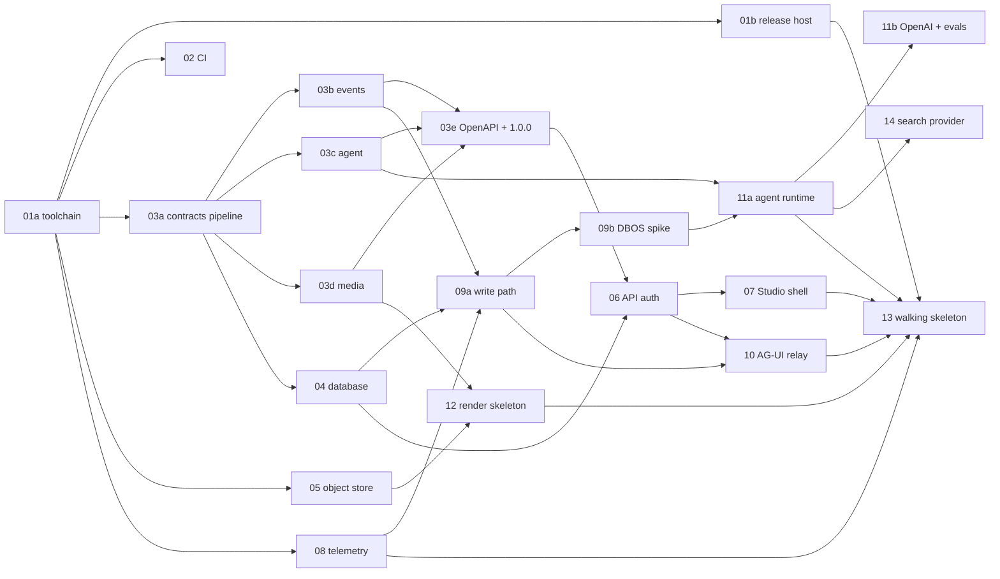

# M0 Foundation: walking skeleton

Status: **Prepared** (Stage 4, 14 Nov 2026; branch `docs/m0-specs`). Next gate: **G4 M0 exit**. Not dated (Q-36); indicative forecast in [DELIVERY_PLAN.md](../DELIVERY_PLAN.md#dates-demos-and-uat).

Owning docs: slice, owner tasks and exit criteria [DELIVERY_PLAN.md](../DELIVERY_PLAN.md#m0-foundation) · spec list and order [DEVELOPMENT_PLAN.md](../DEVELOPMENT_PLAN.md#m0-foundation-walking-skeleton) · tests, Definition of Ready and Done [TEST_STRATEGY.md](../TEST_STRATEGY.md) · progress [STATUS.md](../STATUS.md).

## What M0 delivers

At the end you can sign in to an empty Studio and press **Run system check**: one run goes web → api → worker → agent (fake model) and render → back to the Studio as live steps, in one trace, on a release deployed to local staging; a fresh clone comes up with `make setup` and `make up`; conformance C01–C04 pass ([exit criteria](../DELIVERY_PLAN.md#m0-foundation)).

## Changes made while preparing M0

**Specs split to meet the Definition of Ready** (tech lead decision, confirmed by you 14 Nov 2026). Four G3 specs were expected well over about 400 changed lines. Each part keeps its parent number with a letter, so the dependency order and every later spec ID are unchanged. A later spec that depends on a split spec depends on all its parts.

| G3 spec | Size | Split into | Size | Why |
|---|---|---|---|---|
| SPEC-01 | M (2) | SPEC-01a toolchain and Compose · SPEC-01b release host and staging | M + S (3) | Release, deploy and promote (ADR-022) are a separate concern only SPEC-13 needs |
| SPEC-03 | L (3) | SPEC-03a pipeline, common, workflow requests · 03b events, AG-UI, analytics · 03c agent · 03d media · 03e OpenAPI, TS client, 1.0.0 | M + S + S + S + M (7) | About 3,600 lines of JSON Schema and OpenAPI become canonical Pydantic, each part proven equivalent to 0.4.0; one PR would be several thousand lines |
| SPEC-09 | L (3) | SPEC-09a write path and dispatch · SPEC-09b DBOS kill-and-resume spike | M + M (4) | The spike is the ADR-003 risk and needs its own fault suite and result |
| SPEC-11 | L (3) | SPEC-11a runtime, tool host, fake model · SPEC-11b OpenAI adapter and eval runner | M + M (4) | The eval runner (a PROCESS.md M0 harness) was not in any spec; it goes with the real adapter |

M0 grows from 14 specs and 32 spec-days to **21 specs and 39 spec-days**. The critical path is unchanged at 39 spec-days (SPEC-01a → SPEC-03a → SPEC-04 → SPEC-09a → SPEC-09b → SPEC-26 → …). Plan totals become 90 specs and 192 spec-days.

**Gap raised and decided: Q-43, A-43 accepted 14 Nov 2026** (including the System check as a change to the approved S-01 screen). The M0 exit needs a trivial request and a button, but no contract, task or approved screen element provides one. A-43: a `diagnostic` run behind `FEATURE_DIAGNOSTICS` (on in dev and staging, off in production), added to contracts 1.0.0 by SPEC-03a–03e, with a **System check** entry in the S-01 app shell (SPEC-13). It adds no requirement ([QUESTIONS.md](../../docs/product/QUESTIONS.md)). The splits and the 39 spec-day size were confirmed by you the same day.

**Other choices made in the specs** (tech lead; say so in review if you disagree):
- SPEC-04 creates only the tables M0 uses; each later spec adds its tables from the `db/schema.sql` draft with its own migration.
- SPEC-07 keeps tokens server-side and calls the API through a Next.js route handler (frontend.mdc: tokens stay in Auth.js). Nav items not built yet show the shared unavailable state ("Built in M2").
- SPEC-10 maps outbox events to AG-UI events when the stream is served, reading the outbox by cursor, rather than storing frames (ADR-020 "projection, not source").
- SPEC-12 implements only the `validate` job kind; the other kinds answer "not available until SPEC-23".
- SPEC-14 excludes search APIs that obtain results by scraping another engine (NFR-18) and records the choice in a new ADR-023.
- New test T-98 (release once, promote by digest) added to the catalogue for SPEC-01b.

## Specs in dependency order

Specs in the same group have all their dependencies in earlier groups and can be in flight together, within the limit of two open specs (DEVELOPMENT_PLAN.md, Parallel tracks). SPEC-03b, 03c and 03d touch different contract files and the same package, so open at most two of them at once.

| Group | Spec | Title | Layer | Requirements | Screens | Tests | Depends on | Size | Branch |
|---|---|---|---|---|---|---|---|---|---|
| 1 | [SPEC-01a](specs/SPEC-01a/spec.md) | Repo toolchain, Makefile and Compose stack | X | NFR-13 | — | T-31 | — | M | `feat/SPEC-01a-toolchain` |
| 2 | [SPEC-01b](specs/SPEC-01b/spec.md) | Release host: make release and deploy to local staging | X | NFR-13 | — | T-98 | SPEC-01a | S | `feat/SPEC-01b-release-host` |
| 2 | [SPEC-02](specs/SPEC-02/spec.md) | CI pipeline, security scans and branch rules | X | NFR-05, NFR-06, NFR-13, NFR-18 | — | T-32 | SPEC-01a | M | `feat/SPEC-02-ci-pipeline` |
| 2 | [SPEC-03a](specs/SPEC-03a/spec.md) | Contracts I: pipeline, drift and dual-runtime fixtures, common, workflow requests | X | NFR-19, NFR-11 | — | T-33 | SPEC-01a | M | `feat/SPEC-03a-contracts-pipeline` |
| 2 | [SPEC-05](specs/SPEC-05/spec.md) | Object store choice and BlobStore adapter (ADR-015 amendment) | B | R-30, NFR-04 | — | T-35 | SPEC-01a | M | `feat/SPEC-05-object-store` |
| 2 | [SPEC-08](specs/SPEC-08/spec.md) | Telemetry wiring, Collector redaction and health checks | X | NFR-09, NFR-06, NFR-15 | — | T-38 | SPEC-01a | M | `feat/SPEC-08-telemetry` |
| 3 | [SPEC-03b](specs/SPEC-03b/spec.md) | Contracts II: domain events, AG-UI stream, analytics | X | NFR-19, R-50 | — | T-33 | SPEC-03a | S | `feat/SPEC-03b-contracts-events` |
| 3 | [SPEC-03c](specs/SPEC-03c/spec.md) | Contracts III: agent task, execution and tool contracts | X | NFR-19, R-63 | — | T-33 | SPEC-03a | S | `feat/SPEC-03c-contracts-agent` |
| 3 | [SPEC-03d](specs/SPEC-03d/spec.md) | Contracts IV: media contracts | X | NFR-19, R-18 | — | T-33 | SPEC-03a | S | `feat/SPEC-03d-contracts-media` |
| 3 | [SPEC-04](specs/SPEC-04/spec.md) | Database baseline, migrations, service roles and RLS | B | R-01, NFR-04, NFR-13 | — | T-34, T-07 | SPEC-01a, SPEC-03a | M | `feat/SPEC-04-database` |
| 4 | [SPEC-03e](specs/SPEC-03e/spec.md) | Contracts V: Studio API models, OpenAPI drift, TS client, 1.0.0 | X | NFR-19, NFR-11 | — | T-33 | SPEC-03b, SPEC-03c, SPEC-03d | M | `feat/SPEC-03e-contracts-api` |
| 4 | [SPEC-09a](specs/SPEC-09a/spec.md) | Write path: idempotency, audit, outbox and workflow dispatch | B | NFR-01, R-50 | — | T-01 | SPEC-04, SPEC-03b, SPEC-08 | M | `feat/SPEC-09a-outbox` |
| 4 | [SPEC-12](specs/SPEC-12/spec.md) | Render service skeleton, job API and resource limits | M | R-29, NFR-12 | — | T-40 | SPEC-03d, SPEC-05 | M | `feat/SPEC-12-render-skeleton` |
| 5 | [SPEC-06](specs/SPEC-06/spec.md) | API authentication, members and responsibilities | B | R-01, R-05, NFR-04 | — | T-36, T-37 | SPEC-04, SPEC-03e | M | `feat/SPEC-06-api-auth` |
| 5 | [SPEC-09b](specs/SPEC-09b/spec.md) | DBOS kill-and-resume spike (ADR-003) | B | NFR-01, R-50, R-51 | — | T-04, T-12, T-90 | SPEC-09a | M | `feat/SPEC-09b-dbos-spike` |
| 6 | [SPEC-07](specs/SPEC-07/spec.md) | Studio sign-in and app shell | W | R-01, R-05, R-61 | S-01 | T-15, T-36 | SPEC-06 | M | `feat/SPEC-07-studio-shell` |
| 6 | [SPEC-10](specs/SPEC-10/spec.md) | AG-UI relay and project event stream (ADR-020) | B | R-50, R-61, NFR-04 | — | T-10, T-39, T-07 | SPEC-06, SPEC-09a, SPEC-03b | L | `feat/SPEC-10-agui-relay` |
| 6 | [SPEC-11a](specs/SPEC-11a/spec.md) | Agent runtime, tool host, validation stages and fake model (ADR-021) | A | R-63, NFR-05, NFR-11 | — | T-02, T-08, T-09 | SPEC-03c, SPEC-09b | M | `feat/SPEC-11a-agent-runtime` |
| 7 | [SPEC-11b](specs/SPEC-11b/spec.md) | OpenAI LlmProvider adapter, portability fixtures and eval runner | A | NFR-11, R-63 | — | T-91 | SPEC-11a | M | `feat/SPEC-11b-openai-adapter` |
| 7 | [SPEC-13](specs/SPEC-13/spec.md) | Walking skeleton, traced and deployed to staging | X | NFR-09, NFR-13 | S-01 | T-41, T-38, T-03, T-01, T-15 | SPEC-01b, SPEC-07, SPEC-08, SPEC-10, SPEC-11a, SPEC-12 | M | `feat/SPEC-13-walking-skeleton` |
| 7 | [SPEC-14](specs/SPEC-14/spec.md) | Search API choice and SearchProvider adapter (Q-29) | A | R-08, NFR-11 | — | T-42 | SPEC-11a | M | `feat/SPEC-14-search-provider` |

Layer: X cross-cutting, B backend, A agent, M media, W web (DEVELOPMENT_PLAN.md). Sizes: S 1, M 2, L 3 spec-days; total 39.

**Critical path in M0** (by size, 14 spec-days): SPEC-01a → SPEC-03a → SPEC-04 → SPEC-09a → SPEC-09b → SPEC-11a → SPEC-13, tied with SPEC-01a → SPEC-03a → SPEC-03b → SPEC-03e → SPEC-06 → SPEC-10 → SPEC-13. Start SPEC-01a, then SPEC-03a and SPEC-04 as early as possible; SPEC-02, SPEC-05, SPEC-08 and SPEC-01b have slack.

## Definition of Ready check

Checked against [TEST_STRATEGY.md](../TEST_STRATEGY.md#definition-of-ready) on 14 Nov 2026. ✓ met · ◐ met once the named item lands · ✗ not met.

| Spec | R-xx and ACs (G/W/T) | Contract version named; change is its own first step | Screens and states | T-xx listed and in catalogue | Agent: contract, maturity, evals, conformance | Dependencies merged | Diff about 400 or less | prompt.md | Result |
|---|---|---|---|---|---|---|---|---|---|
| SPEC-01a | ✓ | ✓ none | n/a | ✓ | n/a | ✓ none | ✓ ~400 (config) | ✓ | **Ready** |
| SPEC-01b | ✓ | ✓ none | n/a | ✓ T-98 added | n/a | ◐ SPEC-01a | ✓ ~250 | ✓ | Draft |
| SPEC-02 | ✓ | ✓ none | n/a | ✓ | n/a | ◐ SPEC-01a | ✓ ~350 | ✓ | Draft |
| SPEC-03a | ✓ | ✓ 0.4.0 → generated; A-43 addition | n/a | ✓ | n/a | ◐ SPEC-01a | ✓ ~400 | ✓ | Draft |
| SPEC-03b | ✓ | ✓ A-43 addition | n/a | ✓ | n/a | ◐ SPEC-03a | ✓ ~350 | ✓ | Draft |
| SPEC-03c | ✓ | ✓ A-43 addition | n/a | ✓ | ✓ contracts only | ◐ SPEC-03a | ✓ ~380 | ✓ | Draft |
| SPEC-03d | ✓ | ✓ 0.4.0, no shape change | n/a | ✓ | n/a | ◐ SPEC-03a | ✓ ~380 | ✓ | Draft |
| SPEC-03e | ✓ | ✓ cuts 1.0.0; A-43 addition | n/a | ✓ | n/a | ◐ SPEC-03b–03d | ✓ ~400 | ✓ | Draft |
| SPEC-04 | ✓ | ✓ db/schema.sql draft; M0 tables only | n/a | ✓ | n/a | ◐ SPEC-01a, 03a | ✓ ~380 | ✓ | Draft |
| SPEC-05 | ✓ | ✓ `BlobRef` | n/a | ✓ | n/a | ◐ SPEC-01a | ✓ ~350 | ✓ | Draft |
| SPEC-06 | ✓ | ◐ 1.0.0 (SPEC-03e) | n/a | ✓ | n/a | ◐ SPEC-04, 03e | ✓ ~380 | ✓ | Draft |
| SPEC-07 | ✓ | ◐ 1.0.0 client | ✓ S-01: sign-in, redirecting, authenticator missing, session ended; shell frame | ✓ | n/a | ◐ SPEC-06 | ✓ ~400 | ✓ | Draft |
| SPEC-08 | ✓ | ✓ none | n/a | ✓ | n/a | ◐ SPEC-01a | ✓ ~350 | ✓ | Draft |
| SPEC-09a | ✓ | ✓ generated events | n/a | ✓ | n/a | ◐ SPEC-04, 03b, 08 | ✓ ~380 | ✓ | Draft |
| SPEC-09b | ✓ | ✓ generated set | n/a | ✓ | n/a | ◐ SPEC-09a | ✓ ~380 (mostly tests) | ✓ | Draft |
| SPEC-10 | ✓ | ◐ 1.0.0 stream | n/a | ✓ | n/a | ◐ SPEC-06, 09a | ◐ ~420; split trigger written in the spec | ✓ | Draft |
| SPEC-11a | ✓ | ◐ 1.0.0 agent-tools | n/a | ✓ | ✓ | ◐ SPEC-03c, 09b | ✓ ~420 incl. tests | ✓ | Draft |
| SPEC-11b | ✓ | ✓ 1.0.0 | n/a | ✓ | ✓ | ◐ SPEC-11a | ✓ ~350 | ✓ | Draft |
| SPEC-12 | ✓ | ◐ 1.0.0 media | n/a | ✓ | n/a | ◐ SPEC-03d, 05 | ✓ ~380 | ✓ | Draft |
| SPEC-13 | ✓ | ✓ 1.0.0, no change | ✓ S-01 plus the System check (Q-43) | ✓ | ✓ | ◐ six specs | ✓ ~400 | ✓ | Draft |
| SPEC-14 | ✓ | ✓ 1.0.0 `tools.schema.json` | n/a | ✓ | ✓ | ◐ SPEC-11a | ✓ ~300 + ADR | ✓ | Draft |

Result: **SPEC-01a is Ready now.** Every other spec is complete and becomes Ready when its dependencies merge (Q-43 accepted 14 Nov 2026). No spec fails a content check.

## Conformance due at M0 exit

| Scenario | Test | Built in |
|---|---|---|
| C01 Duplicate transition command | T-01 | SPEC-09a (service), SPEC-13 (HTTP) |
| C02 Tool outside the allowed capability | T-02 | SPEC-11a |
| C03 Two dependencies complete at once | T-03 | SPEC-13 |
| C04 Worker dies after an external write | T-04 | SPEC-09b |

Also started in M0 and due later: C07 (T-07, SPEC-04, SPEC-10; due M2), C08 guard (T-08, SPEC-11a), C09 harness part (T-09, SPEC-11a; due M2), C10 server part (T-10, SPEC-10; due M2), C12 spike part (T-12, SPEC-09b; due M7).

## Your tasks during M0

Listed in [DELIVERY_PLAN.md](../DELIVERY_PLAN.md#m0-foundation) (briefs, renderer and tools desk matrix, measurement sheet, motion and voice references, rights preflight, effort baseline). Tied to specs:
- after SPEC-02 merges: add the thirteen required checks to the `main` ruleset;
- before SPEC-11b's live run: an OpenAI development key in `.env`;
- after SPEC-14 merges: create the search API account and put its key in `.env`;
- at SPEC-13: sign in on staging and run the system check as the M0 demo.

## Exit (G4)

The [PROCESS.md exit checklist](../../docs/PROCESS.md#milestones), the [project additions](../TEST_STRATEGY.md#milestone-exit-g4) and the [M0 criteria](../DELIVERY_PLAN.md#m0-foundation). Release tag at exit: `v0.1.0`. UAT script `plans/M0/uat.md` is drafted in Stage 5.
